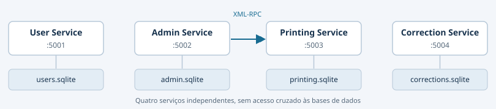
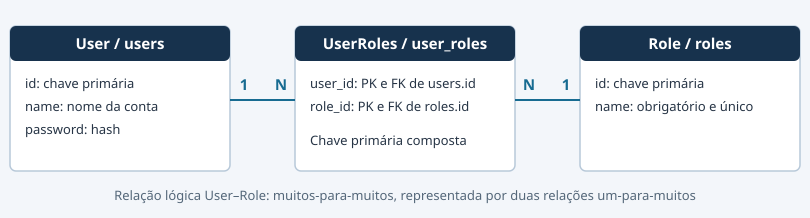

# Sistema de Gestão e Correção de Exames Nacionais

Relatório de implementação — Parte 1

ADInt · 29 de outubro de 2026

**MEEC**
**Grupo 4**

Francisco António Lisboa Guarda (117392)

André Filipe Teigas Vaz (120181)

Documento consolidado a partir do README geral e dos READMEs dos quatro serviços. Os modelos SQLAlchemy foram consultados para completar a descrição das classes e dos campos persistidos.

## 1. Enquadramento e arquitetura

O projeto implementa a primeira parte de um sistema distribuído para apoiar a gestão e a correção de exames nacionais. Abrange o registo de utilizadores, o agendamento de exames, a inscrição de alunos, a impressão de folhas de resolução e o processamento das digitalizações para correção de respostas.

A solução divide-se em quatro aplicações Python independentes. Cada serviço tem as suas páginas, uma porta própria e uma base SQLite da sua responsabilidade. Esta separação permite executar os componentes em processos distintos e prepara a distribuição por máquinas diferentes.

| Serviço | Endereço local | Base de dados predefinida |
| --- | --- | --- |
| User Service | `http://127.0.0.1:5001` | `user_service/users.sqlite` |
| Admin Service | `http://127.0.0.1:5002` | `admin_service/admin.sqlite` |
| Printing Service | `http://127.0.0.1:5003` | `printing_service/printing.sqlite` |
| Correction Service | `http://127.0.0.1:5004` | `correction_service/corrections.sqlite` |



O Admin Service comunica com o Printing Service por XML-RPC, no entanto, não existe acesso cruzado às bases de dados. O Correction Service recebe os PDFs por upload e, nesta fase, não consulta o registo de exames do Admin Service nem os utilizadores do User Service. A figura representa a comunicação implementada entre serviços.

### 1.1. Tecnologias e organização

As aplicações usam **Python**, **Flask**, **SQLAlchemy** e **SQLite**. O Printing Service disponibiliza o endpoint XML-RPC com **Flask-XML-RPC-Reloaded**, um fork compatível com Python 3. A geração e o processamento de PDFs usam **PyMuPDF**, os QR codes são gerados com **qrcode** e detetados no Correction Service com **OpenCV**, com apoio de **NumPy**. O User Service usa o Werkzeug para gerar e verificar hashes de passwords.

Cada diretório de serviço contém a aplicação, o módulo de dados, os templates HTML, as dependências e os testes. Os ficheiros principais são `su_app.py`, `as_app.py`, `ps_app.py` e `cs_app.py`. Na raiz, `clean.py` concentra as operações de limpeza.

## 2. Funcionalidades implementadas

O quadro seguinte relaciona os códigos das funcionalidades com a responsabilidade de cada componente.

| Código | Funcionalidade | Serviço |
| --- | --- | --- |
| SU_1 | Listar utilizadores e respetivos papéis | User |
| SU_2 | Adicionar um utilizador | User |
| SU_3 | Importar utilizadores por CSV | User |
| AD_1 | Agendar e listar exames | Admin |
| AD_2 | Inscrever alunos em lote num exame | Admin |
| AD_3 | Pedir a impressão das folhas de resolução | Admin / Printing |
| AD_4 | Atribuir professores às questões de um exame | Correction |
| AD_5 | Carregar e processar digitalizações em PDF | Correction |
| PR_1 | Listar respostas por corrigir, com a atribuição disponível | Correction |
| PR_2 | Consultar uma resposta e guardar ou editar a correção | Correction |
| PR_3 | Listar respostas já corrigidas | Correction |
| ST_1 | Consultar inscrições e informação dos exames | Admin |
| ST_3 | Consultar digitalizações, páginas e correções, sem identidade do aluno | Correction, implementação parcial |

## 3. User Service

O User Service gere os utilizadores e os seus papéis. Disponibiliza uma página inicial com o total de utilizadores, contagens por papel e atalhos para listar, adicionar e importar registos. Um utilizador é contado uma vez no total e uma vez em cada papel atribuído.

Os papéis disponíveis são `Administrator`, `Professor`, `Exam invigilator` e `Student`. É possível atribuir vários papéis ao mesmo utilizador. A organização em três tabelas foi autorizada pelo professor para preparar a Parte 2.

### 3.1. Criação e importação

A criação individual exige um ID positivo de 64 bits, nome e password não vazios e pelo menos um papel válido e disponível na base de dados. IDs já existentes são rejeitados neste formulário. As passwords são guardadas como hashes e não são apresentadas nas listagens nem novamente preenchidas após um erro.

A importação aceita ficheiros `.csv` em UTF-8. Os cabeçalhos obrigatórios são `id`, `name`, `password` e `role`, sem nomes repetidos. Os papéis múltiplos são separados por "`|`" e cada campo é separado com vírgulas. Linhas vazias são ignoradas. São rejeitados ficheiros sem utilizadores, cabeçalhos inválidos, linhas com campos em falta ou em excesso e codificação inválida.

```csv
id,name,password,role
1001,Ana Silva,exemplo123,Student
2001,Joao Pereira,exemplo456,Professor|Exam invigilator
```

As novas inserções pertencem a uma única transação. Dados inválidos num novo utilizador, papéis indisponíveis ou conflitos com utilizadores existentes rejeitam todo o lote novo. Os registos anteriores mantêm-se. A mensagem de conflito identifica o ID e a linha sem expor passwords. As falhas de integridade na gravação apresentam uma mensagem genérica.

### 3.2. Páginas e endpoints

| Endpoint | Métodos | Finalidade |
| --- | --- | --- |
| `/` | GET | Resumo e navegação |
| `/list_users` | GET | Listar utilizadores e papéis |
| `/list_users/sucess` | GET | Listagem com confirmação de criação ou importação |
| `/users/add` | GET, POST | Formulário e criação individual |
| `/users/bulk-add` | GET, POST | Formulário e importação CSV |

A grafia `sucess` corresponde ao caminho existente na implementação.

### 3.3. Modelos SQLAlchemy e decisão de modelação

**A principal diferença de modelação face à proposta simplificada do enunciado encontra-se em `user_service/user_data.py`.** Na secção 2.1.1, o enunciado apresenta uma única tabela de utilizadores com nome, identificador, password e um campo `role`. A implementação separa os dados da conta, o catálogo de papéis e as atribuições desses papéis em três tabelas relacionadas. Esta opção foi discutida e autorizada pelo professor para preparar a Parte 2 do projeto.

#### 3.3.1. Da tabela única à relação muitos-para-muitos

Um utilizador pode desempenhar mais do que um papel: por exemplo, um professor pode também ser vigilante de exames. A identidade e a password pertencem à conta, enquanto os papéis representam as funções que essa conta pode desempenhar. Assim, a implementação mantém um único registo de utilizador e permite associá-lo a vários registos de papéis. Esta separação evita duplicar a conta e o hash da password para cada função e evita guardar listas de papéis numa coluna de texto.



#### 3.3.2. Responsabilidade de cada tabela

| Modelo ou associação | Tabela | Campos persistidos |
| --- | --- | --- |
| `User` | `users` | `id` (PK), `name`, `password`  |
| `Role` | `roles` | `id` (PK), `name` (único) |
| `UserRoles` | `user_roles` | `user_id` e `role_id` (PK composta de FKs) |

`User` é a classe que representa a conta. O identificador do user `id` é a chave primária, `name` e `password` são obrigatórios e não podem ser nulos.

`Role` é a classe que representa um papel partilhado por várias contas. Tem uma chave primária inteira e um nome obrigatório e único. O catálogo é inicializado com `Administrator`, `Professor`, `Exam invigilator` e `Student`.

`UserRoles` é uma tabela da associação de `User` com `Role`. Cada linha liga um utilizador `user_id` a um papel `role_id`. Ambos os campos integram a chave primária composta e são chaves estrangeiras para as tabelas de origem. A chave composta impede que o mesmo papel seja atribuído duas vezes à mesma conta.

#### 3.3.3. Relações ORM e integridade

A relação lógica entre `User` e `Role` é **muitos-para-muitos**. No esquema relacional, cada utilizador pode ter várias linhas em `user_roles` e cada papel pode aparecer em linhas de vários utilizadores.

No SQLAlchemy, `User.roles` e `Role.users` usam `relationship`, com `secondary=UserRoles` para indicar a tabela intermédia e `back_populates` para ligar os dois lados da relação. Estas propriedades são relações ORM e não acrescentam colunas de listas às tabelas.

As chaves estrangeiras são ativadas em cada ligação SQLite. Impedem associações a utilizadores ou papéis inexistentes e a eliminação direta em SQL de registos ainda referenciados. A unicidade de `Role.name` impede duplicar um papel no catálogo. Regras como exigir pelo menos um papel por conta, aceitar apenas os nomes previstos e confirmar a sua disponibilidade são também verificadas pela aplicação antes da gravação.

#### 3.3.4. Preparação para a Parte 2

Esta organização permite que a futura autenticação reconheça uma única conta e que a autorização consulte todos os papéis dessa conta para determinar as funcionalidades disponíveis. Alterar uma atribuição passa por alterar a associação, sem duplicar a identidade ou as credenciais do utilizador. A estrutura prepara essa evolução. O controlo de acesso e a filtragem por utilizador continuam fora da implementação da Parte 1.

## 4. Admin Service

O Admin Service agenda exames, importa inscrições de alunos, apresenta a informação das inscrições e envia pedidos de impressão. O painel inicial mostra contagens reais de exames e inscrições, atalhos e um guia de preparação.

### 4.1. Agendamento e inscrições

O agendamento exige uma unidade curricular não vazia, com até 200 caracteres, e uma data igual ou posterior à data atual do servidor. O ID do exame é gerado pela base de dados. Nos URLs, exames inexistentes ou IDs fora do intervalo positivo de 64 bits devolvem HTTP 404.

A inscrição aceita CSV UTF-8, com ou sem BOM, com uma coluna de identificação: `student_id` ou `student_identifier`. Os cabeçalhos são normalizados sem distinguir maiúsculas de minúsculas e têm de ser únicos. A presença simultânea das duas colunas de identificação é rejeitada. Colunas adicionais são permitidas quando declaradas no cabeçalho e vírgulas dentro de campos são aceites entre aspas.

```csv
student_id
1001
1002
```

IDs repetidos no CSV e alunos já inscritos nesse exame são ignorados. Um aluno inscrito noutro exame pode ser inscrito no exame selecionado. As novas inscrições são guardadas numa única transação e erros de estrutura ou de identificadores rejeitam o lote e identificam a linha quando aplicável. O Admin não valida os IDs de alunos na base do User Service.

A confirmação apresenta apenas o número de novas inscrições. Se não existir nenhuma, informa `No new students were enrolled.` com `count=0`. As inscrições existentes mantêm-se inalteradas.

Depois da data do exame, inscrições e impressão são bloqueadas. No próprio dia continuam permitidas. A listagem oculta as ações quando estão encerradas e o formulário de inscrição de um exame passado devolve HTTP 409.

### 4.2. Páginas e endpoints

| Endpoint | Métodos | Finalidade |
| --- | --- | --- |
| `/` | GET | Painel de exames e inscrições |
| `/exams/schedule` | GET, POST | Agendar exame |
| `/exams` | GET | Listar exames e ações disponíveis |
| `/exams/success` | GET | Confirmar agendamento |
| `/exams/<exam_id>/enroll` | GET, POST | Inscrever alunos por CSV |
| `/enrollments` | GET | Listar inscrições e dados do exame |
| `/enrollments/success` | GET | Confirmar novas inscrições |
| `/exams/<exam_id>/order-printing` | POST | Pedir impressão por XML-RPC |
| `/exams/printing/success` | GET | Confirmar envio do pedido |

### 4.3. Modelos e comunicação

Os modelos são definidos em `admin_service/admin_data.py`.

| Modelo | Tabela | Campos persistidos |
| --- | --- | --- |
| `Exam` | `exams` | `id` (PK gerada), `date`, `course` |
| `Enrollment` | `enrolled_students` | `exam_id` e `student_id` (PK composta), `exam_id` é FK |

As chaves estrangeiras impedem inscrições em exames inexistentes. A eliminação de um exame elimina as respetivas inscrições em cascata.

Inscrever alunos não contacta o Printing Service. A geração ou atualização de PDFs exige um pedido explícito com `Order printing`, que usa as inscrições persistidas nesse momento, incluindo depois de reiniciar o Admin. O Printing pode estar desligado durante a inscrição.

As chamadas HTTP e HTTPS usam um timeout de 30 segundos para as operações de rede. Falhas de comunicação, rejeições, faults e respostas XML-RPC inválidas são traduzidas em mensagens próprias. Se as inscrições mudarem durante um pedido, o Admin volta a consultar a lista e pode repetir o envio até três tentativas. Alterações contínuas originam uma mensagem para pedir novamente a atualização.

## 5. Printing Service

O Printing Service recebe pedidos por XML-RPC e gera um único PDF com todas as folhas de resolução do exame. A interface web lista os exames impressos, o número de folhas e de páginas e permite consultar ou guardar a versão atual do PDF.

### 5.1. Contrato XML-RPC

```python
print_exam(exam_id, exam_date, course, student_ids)
```

| Argumento | Representação e validação |
| --- | --- |
| `exam_id` | Inteiro positivo ou texto decimal até `2**63 - 1` |
| `exam_date` | Texto no formato `YYYY-MM-DD` e não pode estar no passado |
| `course` | Texto não vazio |
| `student_ids` | Lista não vazia de IDs válidos, sem repetições |

O Admin envia o ID do exame e os IDs de alunos como textos decimais para evitar o limite de 32 bits dos inteiros XML-RPC. O Printing normaliza os valores e guarda-os como inteiros no SQLite. Valores inválidos, repetidos ou fora do intervalo são rejeitados. A data é novamente validada no próprio endpoint, incluindo em chamadas diretas.

### 5.2. Geração, repetição e recuperação

O modelo é `printing_service/Exam-template.pdf`. A página introdutória é omitida e as quatro páginas de questões são copiadas para cada aluno. Para `n` alunos, o resultado tem exatamente `4 × n` páginas.

Cada folha tem um ID único, usado nos QR codes das suas quatro páginas. São colocados códigos nos quatro cantos de cada página. O ID da folha é distinto do identificador do aluno. A base mantém o par exame/aluno necessário para preservar a mesma folha em pedidos posteriores.

Repetir um pedido sem alterações reutiliza o PDF e os IDs existentes. Novos alunos acrescentam quatro páginas cada um. Listas antigas não removem alunos nem invalidam QR codes emitidos. Por exemplo, passar de dois para quatro alunos aumenta o PDF de oito para dezasseis páginas apenas depois de um novo pedido explícito.

Pedidos simultâneos são serializados no SQLite. O PDF é persistido na base e copiado para `output/exam_<exam_id>.pdf`, usando um ficheiro temporário e substituição da cópia. Se a confirmação da transação falhar após publicar o ficheiro, a recuperação volta a obter um bloqueio de escrita e repõe a versão atualmente confirmada na base, preservando um pedido mais recente. Se falhar a primeira criação e não existir exame confirmado, remove a cópia.

O botão `Save to output` guarda a versão já persistida, recria a pasta se necessário e substitui cópias antigas. Esta ação não gera novas folhas nem consulta o Admin. O ficheiro é guardado na máquina do serviço, sem iniciar um download no navegador. PDFs previamente gerados continuam disponíveis depois da data do exame.

### 5.3. Páginas e endpoints

| Endpoint | Métodos | Finalidade |
| --- | --- | --- |
| `/` ou `/exams` | GET | Listar exames impressos e ações de PDF |
| `/RPC2` ou `/` | POST XML-RPC | Receber `print_exam` |
| `/exams/<exam_id>/pdf` | GET | Consultar o PDF guardado no navegador |
| `/exams/<exam_id>/pdf/save` | POST | Guardar a cópia atual em output |
| `/exams/pdf/saved` | GET | Confirmar gravação da cópia |

### 5.4. Modelos SQLAlchemy

Os modelos são definidos em `printing_service/printing_data.py`.

| Modelo | Tabela | Campos persistidos |
| --- | --- | --- |
| `PrintedExam` | `printed_exams` | `id` (PK), `exam_date`, `course`, `pdf_file` |
| `ResolutionSheet` | `resolution_sheets` | `id` (PK autoincrementada), `exam_id` (FK), `student_id` |

O par exame/aluno é único. A associação `PrintedExam.sheets` conserva a ordem dos IDs e elimina folhas órfãs quando o exame é removido. As colunas binárias de PDF têm carregamento diferido. Os IDs de folhas confirmadas não são reutilizados na mesma base de dados.

## 6. Correction Service

O Correction Service recebe digitalizações, atribui professores a questões e permite consultar, guardar e editar correções. Funciona independentemente dos registos dos restantes serviços nesta fase. A página inicial apresenta o número de PDFs, páginas, respostas corrigidas, respostas pendentes e a percentagem de conclusão.

### 6.1. Atribuição de professores

Os IDs do exame e do professor são introduzidos manualmente e têm de ser positivos de 64 bits. As questões válidas são 1 a 4. A atribuição pode existir antes do carregamento das digitalizações. Não é feita uma consulta ao Admin para validar a existência do exame nem ao User para confirmar o papel do professor.

Cada par exame/questão tem um professor, e cada professor pode assumir apenas uma questão por exame. O mesmo professor pode participar em exames diferentes. Antes de existirem respostas corrigidas para esse exame/questão, pode ser substituído. Depois da primeira correção, incluindo uma nota zero, a alteração é recusada. Repetir exatamente a mesma atribuição apresenta uma mensagem sem modificar os dados.

Alterações de atribuição e gravações de notas são serializadas no SQLite para que um pedido concorrente não ultrapasse as verificações de bloqueio.

### 6.2. Upload e processamento das digitalizações

O upload aceita PDF até 50 MB. Ficheiros ausentes, vazios, ilegíveis ou protegidos por password são rejeitados. Os IDs do exame são validados e os ficheiros recebem um nome seguro para registo na base.

São aceites digitalizações com quatro páginas de resposta por folha (`4 × n`) e PDFs com uma página introdutória seguida das folhas completas (`4 × n + 1`). No segundo caso, a primeira página é ignorada no processamento. Assim, o exemplo de cinco páginas produz quatro respostas. Totais incompletos são rejeitados.

O PDF original é preservado. Para produzir as páginas de correção, o serviço normaliza a rotação sem alterar a aparência, separa as páginas e deteta QR codes na imagem completa e em regiões sobrepostas, combinando deteção múltipla e individual. Os códigos encontrados são cobertos a cinzento.

São guardados um PNG e um PDF de uma página para cada resposta. O PDF processado é reconstruído a partir da imagem já coberta, evitando recuperar o QR code através da remoção de uma simples sobreposição no PDF. Todo o lote é persistido apenas depois de terminar o processamento de todas as páginas.

As respostas recebem números sequenciais de página e de folha e são associadas às questões 1–4 pela ordem das páginas. As atribuições são consultadas nas listagens, pelo que uma atribuição criada depois do upload passa a aplicar-se às respostas correspondentes.

### 6.3. Correção e consulta

A correção só pode ser guardada ou editada depois de existir uma atribuição para o par exame/questão. Sem atribuição, o GET e o POST da rota de correção devolvem HTTP 409 e a interface apresenta a opção de atribuir professor. As páginas PDF e PNG continuam disponíveis para consulta.

A nota tem de ser um número finito e não negativo. São rejeitados valores negativos, `NaN` e infinito, e zero é uma correção válida. **Não está definido um limite máximo por questão.** O comentário é opcional. A gravação marca a resposta como avaliada e atualiza as listagens e o progresso. Não é calculada a nota final agregada do exame.

As listas de respostas e digitalizações são públicas e não são filtradas por professor ou aluno. ST_3 é parcial: permite consultar os documentos e as correções, mas não identifica o aluno. O PDF original pode ser descarregado separadamente.

### 6.4. Páginas e endpoints

| Endpoint | Métodos | Finalidade |
| --- | --- | --- |
| `/` | GET | Painel e progresso da correção |
| `/assignments` | GET, POST | Listar e criar ou alterar atribuições |
| `/assignments/success` | GET | Confirmar atribuição |
| `/scans/upload` | GET, POST | Carregar e processar PDF |
| `/answers` | GET | Listar respostas pendentes |
| `/answers/<id>/correct` | GET, POST | Consultar e guardar ou editar correção |
| `/answers/corrected` | GET | Listar respostas corrigidas |
| `/answers/corrected/success` | GET | Confirmar correção |
| `/scans` | GET | Listar digitalizações, páginas e correções |
| `/scans/success` | GET | Confirmar upload e quantidade de páginas |
| `/answers/<id>/page.pdf` | GET | Consultar a página PDF processada |
| `/answers/<id>/page.png` | GET | Consultar a imagem processada |
| `/scans/<id>/original.pdf` | GET | Descarregar o PDF original |

IDs inexistentes ou fora do intervalo positivo de 64 bits devolvem HTTP 404. O limite de upload é comunicado com HTTP 413 quando excedido. As confirmações mantêm-se após atualizar a página e não dependem de sessões Flask.

### 6.5. Modelos SQLAlchemy e relações de correção

Os modelos definidos em `correction_service/correction_data.py` separam três responsabilidades: configurar quem corrige cada questão, preservar a digitalização original e guardar cada resposta com a respetiva avaliação. A decisão de modelação do User Service, que se afasta da tabela única apresentada no enunciado, é desenvolvida na secção 3.3.

| Modelo | Tabela | Campos persistidos |
| --- | --- | --- |
| `ProfessorAssignment` | `professor_assignment` | `id` (PK), `professor_id`, `exam_id`, `question_number` |
| `ExamCorrectionPdf` | `exam_correction_pdfs` | `id` (PK), `exam_id`, `filename`, `pdf_file` |
| `QuestionCorrection` | `question_corrections` | `id` (PK), `exam_correction_pdf_id` (FK), `page_number`, `sheet_number`, `question_number`, `page_pdf_file`, `page_png_file`, `evaluated`, `grade`, `comment` |

#### 6.5.1. Atribuição independente das digitalizações

`ProfessorAssignment` identifica a atribuição de um professor a uma questão de um exame. A restrição única sobre `exam_id` e `question_number` garante uma atribuição por questão. A restrição sobre `exam_id` e `professor_id` limita cada professor a uma questão nesse exame. Existem ainda verificações de IDs positivos e do intervalo de questões entre 1 e 4.

Esta tabela não depende da existência de um PDF: permite configurar as atribuições antes do upload. `exam_id` e `professor_id` são referências lógicas introduzidas manualmente, sem chaves estrangeiras para as bases do Admin ou do User Service. Isto mantém a independência dos serviços nesta parte do projeto.

#### 6.5.2. PDF original e respostas individuais

`ExamCorrectionPdf` representa um upload e conserva o ID do exame, o nome do ficheiro e os bytes do PDF original. `QuestionCorrection` representa uma página de resposta desse upload, guardando a versão PDF processada, a imagem PNG, a numeração e a avaliação.

A relação entre estes modelos é **um-para-muitos**: um upload origina várias respostas. A chave estrangeira `exam_correction_pdf_id` liga cada resposta à sua origem. As propriedades `ExamCorrectionPdf.corrections` e `QuestionCorrection.source` são bidirecionais, através de `back_populates`. A configuração `cascade="all, delete-orphan"` remove as respostas dependentes quando a origem é eliminada pelo ORM ou quando deixam de pertencer à sua coleção. Não é uma cascata SQL declarada com `ON DELETE CASCADE`.

O par origem/número de página é único. `page_number` identifica a posição da resposta processada. `sheet_number` é uma numeração interna da folha dentro do upload, não o ID do QR code nem a identidade do aluno. Ambos são positivos. `question_number` varia de 1 a 4. Os PDFs e PNGs são colunas binárias com carregamento diferido, evitando carregá-los automaticamente em todas as consultas.

#### 6.5.3. Avaliação e associação ao professor

`evaluated`, `grade` e `comment` pertencem à resposta individual. A restrição de avaliação mantém a nota nula enquanto a resposta está pendente e exige uma nota não nula e não negativa quando está avaliada. Zero é válido. A aplicação complementa esta restrição ao rejeitar valores não finitos. Não existe uma cotação máxima configurada.

Não existe uma chave `assignment_id` em `QuestionCorrection`. O professor é obtido pelo par formado pelo exame da origem e pela questão da resposta. Isto permite que uma atribuição posterior ao upload passe a aplicar-se às respostas já guardadas. Como a associação é consultada desta forma, a aplicação bloqueia a troca de professor após a primeira correção desse exame/questão, preservando a interpretação das avaliações existentes.

## 7. Execução

Na raiz do repositório, criar um ambiente virtual e instalar as dependências dos quatro serviços. Os comandos seguintes destinam-se ao PowerShell.

```powershell
python -m venv venv
.\venv\Scripts\python.exe -m pip install -r user_service\requirements.txt
.\venv\Scripts\python.exe -m pip install -r admin_service\requirements.txt
.\venv\Scripts\python.exe -m pip install -r printing_service\requirements.txt
.\venv\Scripts\python.exe -m pip install -r correction_service\requirements.txt
```

Iniciar cada aplicação numa janela de terminal diferente, mantendo a raiz como diretório de trabalho.

```powershell
.\venv\Scripts\python.exe user_service\su_app.py
.\venv\Scripts\python.exe admin_service\as_app.py
.\venv\Scripts\python.exe printing_service\ps_app.py
.\venv\Scripts\python.exe correction_service\cs_app.py
```

O User, o Admin e o Correction arrancam em modo de desenvolvimento. Os serviços devem ser reiniciados depois de atualizar o código quando necessário, em particular o Printing para carregar alterações na implementação XML-RPC.

## 8. Âmbito da Parte 1

### 8.1. Limites funcionais atuais

A implementação entregue é a dos serviços independentes da Parte 1. As funcionalidades seguintes pertencem às etapas posteriores descritas na documentação do projeto:

- Portal unificado ou proxy de acesso aos vários serviços.
- Autenticação e controlo de acesso por papel.
- Filtragem das listagens segundo o professor ou aluno autenticado.
- Associação, pelo vigilante, entre o aluno presente e a folha efetivamente utilizada na prova (EI_1).
- Cálculo e apresentação da nota final agregada do exame (ST_2).
- Consulta das digitalizações e correções associada à identidade do aluno. ST_3 permanece parcial nesta fase.

O Correction não valida os exames no Admin nem os professores no User. A atribuição de professores pode anteceder o upload. A nota de uma questão tem validação numérica, mas não tem cotação máxima configurada. Estas características fazem parte do comportamento documentado da implementação atual.

### 8.2. Documentação

O conteúdo funcional e operacional foi consolidado a partir dos seguintes ficheiros do repositório:

- `README.md`: arquitetura geral, funcionalidades, execução, testes, limpeza e âmbito.
- `user_service/README.md`: gestão de utilizadores e papéis, regras de CSV, dados e validações.
- `admin_service/README.md`: agendamento, inscrições, bloqueios por data e pedidos XML-RPC.
- `printing_service/README.md`: contrato de impressão, estabilidade de QR codes, PDFs e recuperação.
- `correction_service/README.md`: atribuições, digitalizações, processamento e correção.

Os ficheiros `user_data.py`, `admin_data.py`, `printing_data.py` e `correction_data.py` foram usados para completar a identificação das classes SQLAlchemy, campos, relações e restrições. A contagem e os resultados dos testes foram confirmados no estado do projeto usado para gerar este documento.
